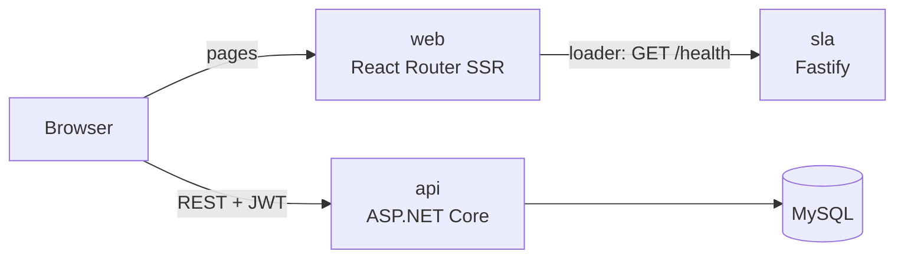

# PulseDesk

Help desk ticketing system. Monorepo with a server-rendered React web app, an ASP.NET Core API and a Node SLA service.

## Architecture



| Path | Service | Stack |
|---|---|---|
| `apps/web` | Web tier, server-side rendered | React 19, React Router 8 (framework mode), Tailwind |
| `services/api` | Tickets, users, auth | .NET 10, EF Core 9, MySQL 8.4 |
| `services/sla` | SLA service | Node, Fastify 5, TypeScript |

## Run

Requires Docker.

```bash
docker compose up --build
```

| URL | |
|---|---|
| http://localhost:5173 | Web |
| http://localhost:5173/status | SLA status, rendered on the server |
| http://localhost:5286/swagger | API docs |
| http://localhost:3001/health | SLA health |

Defaults are for local use. Override them in `.env` (see `.env.example`). `docker compose down -v` resets the database.

## Develop

Node 22.22+ for `apps/web` and `services/sla`; .NET 10 SDK for `services/api` (see [services/api/README.md](services/api/README.md)).

```bash
cd services/sla && npm ci && npm run dev    # :3001
cd apps/web     && npm ci && npm run dev    # :5173
```

Tests and type checks in each Node project: `npm test`, `npm run typecheck`.

## Next

- Move the API to PostgreSQL with EF Core migrations
- Move auth from localStorage to an httpOnly cookie, so pages can render signed-in content on the server
- Publish ticket events from the API to Redpanda; consume them in the SLA service
- CI for tests and builds
